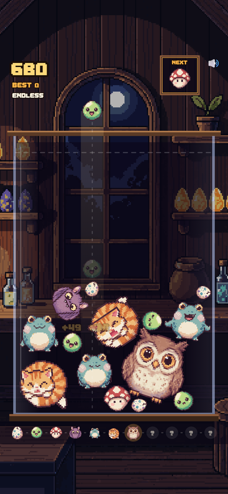
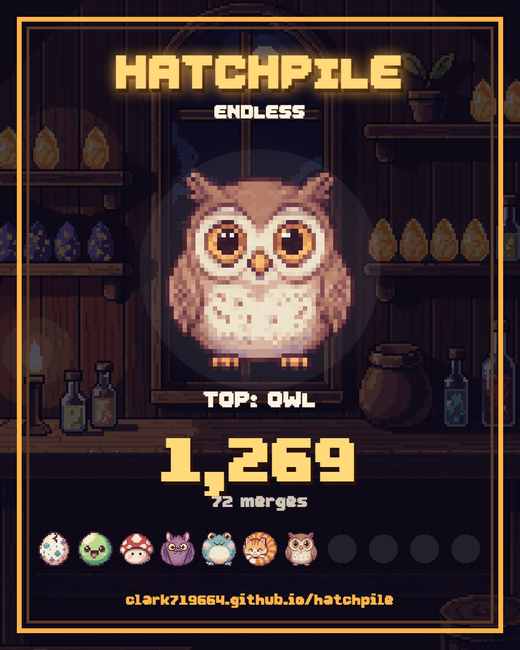

# Hatchpile

**Drop eggs. Merge critters. Hatch the Dragon.**

A cozy physics merge puzzle with a new shared puzzle every day. It runs in any browser and as an Android app, from the same code.

<p align="center">
  
  
</p>

## Play

- **Web:** https://clark719664.github.io/hatchpile/ (installable, works offline after the first visit)
- **Android:** download `Hatchpile.apk` from the [latest release](https://github.com/clark719664/hatchpile/releases/latest)

### Installing the APK

1. Open the release page on your phone and download `Hatchpile.apk`.
2. Open the file. Android will ask to allow installs from your browser or file manager. Allow it once.
3. Tap Install.

The APK is signed with the project's release key. SHA-256 of the current build:

```
93996b4df859e92c2a68dd032dbdc9fd4de6be3709384d303a56064c4ad83370
```

Requires Android 6.0 or newer. The app requests no permissions at all, not even internet access, and works fully offline.

## How it works

Drop critters into the jar. Two touching critters of the same kind merge into the next one up:

> Egg → Slime → Shroomling → Bat → Frog → Cat → Owl → Boar → Bear → Golem → **Dragon**

**Modes**

- **Daily:** everyone gets the same egg sequence that day, seeded from the local date. Numbered from #1 on 2026-10-31. Finish runs on consecutive days to build a streak.
- **Endless:** a fresh random sequence every run.

**Scoring.** Merging into tier *n* scores the triangular series 1, 3, 6, 10, 15, 21, 28, 36, 45, 55, 66. Merges within 0.9 seconds of each other chain a combo, and each step adds 25%.

**Golden Eggs.** After the first 15 drops, about 1 in 22 pieces is a Golden Egg. It merges with the first critter it touches, up to a Boar, and that merge scores double. Touch anything bigger and it cracks into a plain Egg.

**Dragon's Breath.** Hatching a Dragon incinerates the six smallest critters in the jar for 5 points each. Two Dragons touching vanish together for 300 points ("Dragon ascends").

**Game over.** A settled critter above the dashed danger line for about 1.1 seconds ends the run. The jar then collapses and the result screen renders a 1080x1350 share card.

**Sharing.** On a phone, Share sends the card image and a text result to any app. On desktop it copies the text and "Save card" downloads the PNG. The text looks like this:

```
Hatchpile #12 🔥4
Top critter: 🦉 Owl
Score 2,340 · 31 merges
🥚🟢🍄🦇🐸🐱🦉⬛⬛⬛⬛
https://clark719664.github.io/hatchpile/
```

## Controls

| Input | Action |
| --- | --- |
| Drag / move | Aim |
| Release / click | Drop |
| ← → | Aim |
| Space / Enter / ↓ | Drop |
| M | Mute everything |

Music and sound effects have separate toggles under "Critterdex & options" on the title screen. Android's back button returns to the menu.

## Run locally

Any static server works:

```bash
npm run serve
```

Then open http://localhost:8741. Everything it needs, including the physics engine, is in the repo.

## Build the Android APK

You need Node 20+, JDK 21 and the Android SDK (platform 35 and build-tools).

```bash
npm install
npm run android:sync
cd android
./gradlew assembleRelease
```

The APK lands in `android/app/build/outputs/apk/release/`. Without a signing key it is signed with the debug key, which installs fine. To sign with your own key, set `HATCHPILE_KEYSTORE` (path to a `.jks` with alias `hatchpile`) and `HATCHPILE_KS_PASS` before running Gradle.

The **Android APK** GitHub Actions workflow does the same on a runner. Run it from the Actions tab and download the `Hatchpile-apk` artifact. CI builds are debug-signed unless you add `ANDROID_KEYSTORE_B64` (the keystore, base64-encoded) and `ANDROID_KEYSTORE_PASSWORD` as repository secrets. The APK on the Releases page is signed with the project's own release key, which is not stored in this repo.

## Deploy the web app

No build step. Serve the repo root from any static host. GitHub Pages is configured to serve `main` at the root. Bump `VERSION` in `sw.js` whenever you ship a change so installed copies refresh.

## Art credits

Everything in `assets/` was generated with [PixelLab](https://pixellab.ai):

- `c00.png` to `c10.png` and `gold.png`: `create_object_pro_flash`, with the Egg as the shared style anchor. At load time each sprite's resting pose is measured and fitted to its physics circle, so the body you see is the body that collides; idle-animation frames (wing flaps, arm swings) are allowed to overflow the circle.
- `a00.png` to `a10.png` and `agold.png`: 9-frame idle loops from `animate_object` (v3 mode), exported through the object spritesheet endpoint and cropped to one horizontal strip each.
- `bg.png`: the wizard's hatchery backdrop, `create_image_pixflux` at 220x380, drawn at 2x.
- `hatchpile.ttf`: the UI font, `create_font` (16px, bold).
- `panel.png`: the title-screen frame, `create_ui_asset`, used as a CSS border-image.

Music and sound effects are synthesized in WebAudio at runtime. See [THIRD_PARTY.md](THIRD_PARTY.md) for the physics engine and Android wrapper licenses.

## License

[MIT](LICENSE)
